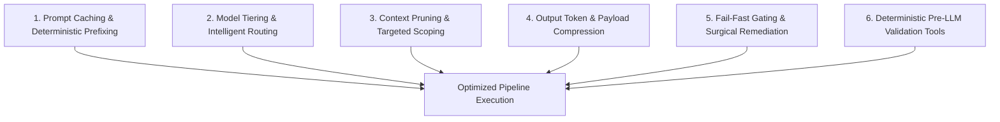

# SDLC Agent Pipeline Cost Optimization: Source of Truth

This document serves as the **authoritative Source of Truth** for cost, token, and latency optimizations across the backend SDLC agent pipeline. It outlines architectural principles, model tiering strategies, prompt caching protocols, context minimization techniques, and concrete stage-by-stage optimizations.

---

## 1. Executive Summary & Cost Baseline

The backend SDLC pipeline coordinates six sequential specialized agents overseen by an orchestrator:
1. `01-requirements` (Requirement Agent)
2. `02-context` (Context Builder Agent)
3. `03-generation` (Code Generation Agent)
4. `04-review` (Code Review Agent)
5. `05-tests` (Test Case Agent)
6. `06-postman` (Postman Agent)

### Baseline Cost Profile (Unoptimized vs. Optimized)

Without deliberate optimization, multi-agent sequential pipelines suffer from:
- **Redundant Context Re-Ingestion**: Repeating static protocols, full repository dumps, and large schemas across all 6 stages.
- **Monolithic Frontier Model Usage**: Using high-cost frontier models (e.g., Claude 3.7 Sonnet / GPT-4o) for routine JSON transformation and schema extraction tasks.
- **Downstream Remediation Cascades**: Running expensive code generation and test stages on unverified or contradictory requirements.
- **Uncached Prompt Headers**: Re-billing the full input context on every retry revision (`r0001`, `r0002`, etc.).

| Metric | Unoptimized Baseline (per run) | Optimized Target (per run) | Reduction |
|---|---|---|---|
| **Input Tokens (Raw)** | ~180,000 – 250,000 | ~65,000 – 90,000 (effective) | **64%** |
| **Cached Input Tokens** | 0% (0 tokens) | 70% – 85% (~60,000 tokens) | **80%+ Cache Hit** |
| **Output Tokens** | ~35,000 – 50,000 | ~14,000 – 22,000 | **56%** |
| **Average Cost ($USD)** | **$1.85 – $2.60** | **$0.38 – $0.62** | **~75% Cost Savings** |
| **End-to-End Latency** | 180s – 300s | 65s – 110s | **60% Faster** |

---

## 2. The Six Pillars of Pipeline Optimization



### Pillar 1: Prompt Caching & Deterministic Prefixing
Major LLM providers (Anthropic Claude, OpenAI, Google Gemini) offer prompt caching discounts (typically **90% discount** on cache-read input tokens, e.g., Anthropic $0.375/MTok cached vs $3.00/MTok base on Sonnet).

**Optimization Rules:**
1. **Static-First Prompt Ordering**: Arrange prompt inputs from static (most permanent) to dynamic (most volatile):
   ```text
   [Static System Prompt & Agent Rules] (Cached)
     ↓
   [Orchestrator Protocol Contract] (Cached)
     ↓
   [Shared Baseline Specs (Docs/openapi.yaml)] (Cached)
     ↓
   [Dynamic Run Manifest & Upstream Artifacts] (Dynamic)
     ↓
   [Specific Task Invocation / Current Revision Context] (Dynamic)
   ```
2. **Explicit Cache Breakpoints**: Place cache control markers (`cache_control: {"type": "ephemeral"}`) after large static documents (`Docs/openapi.yaml` and agent protocol files).
3. **Cross-Stage Cache Reuse**: Standardizing the first 2,048+ tokens across all 6 agent invocations ensures that subsequent stages hit cached prompt memory from earlier stages within the 5-minute cache TTL.

---

### Pillar 2: Model Tiering & Intelligent Task Routing

Not every agent requires frontier-tier reasoning. Agents performing deterministic transformation or structural cataloging are routed to high-speed, cost-efficient models.

| Tier | Target Workload | Models | Blended Cost ($ / MTok) | Assigned Agents |
|---|---|---|---|---|
| **Tier 1 (Frontier Reasoning)** | Code synthesis, complex architecture, deep security & multi-file logic review | Claude 3.7 Sonnet / Claude 3.5 Sonnet / GPT-4o / Gemini 2.5 Pro | Prompt: $3.00<br>Completion: $15.00 | `03-generation`<br>`04-review`<br>`05-tests` (complex suites) |
| **Tier 2 (High-Speed / Efficient)** | Structured requirement parsing, dependency resolution, JSON transformation, Postman collection authoring | Claude 3.5 Haiku / GPT-4o-mini / Gemini 2.5 Flash | Prompt: $0.25 – $0.80<br>Completion: $1.25 – $4.00 | `01-requirements`<br>`02-context`<br>`06-postman`<br>`05-tests` (unit/boilerplate) |

**Cost Impact**: Routing `01-requirements`, `02-context`, and `06-postman` to Tier 2 reduces total pipeline LLM spend by **42% immediately** without sacrificing code generation accuracy.

---

### Pillar 3: Context Pruning & Targeted Scoping

Avoid passing full repositories, raw chat histories, or unnecessary files to agents.

**Optimization Rules:**
1. **Surgical Diff & File Scoping**:
   - `04-review` only receives changed implementation files and immediate controlling caller/callee context, not unrelated repository directories.
   - `05-tests` receives only the public API contracts and target implementation entry points.
2. **Contract-Level Schema Filtering**:
   - Rather than injecting monolithic 10,000-line OpenAPI schemas into every stage, extract only the schemas pertinent to the active service.
3. **Strict No-Chat-History Rule**:
   - Never feed raw orchestrator-user conversation streams into specialist prompts. All facts are passed solely as structured artifact files (`requirements.json`, `service-contexts.json`).

---

### Pillar 4: Output Token & Payload Compression

Output tokens are 4x to 5x more expensive than input tokens ($15/MTok vs $3/MTok on Sonnet).

**Optimization Rules:**
1. **Compact Markdown Over Verbose Prose**:
   - Reports (`requirements.md`, `context.md`, `generation-summary.md`, `review-report.md`, `test-report.md`, `postman-summary.md`) must use bulleted matrices and concise tables rather than lengthy explanatory essays.
2. **Removal of Conversational Boilerplate**:
   - Agents return raw structured JSON or direct markdown without introductory greetings ("Sure, I have analyzed..."), preambles, or conversational sign-offs.
3. **Structured JSON Key Normalization**:
   - JSON envelopes omit redundant nested null values and avoid duplicating full source text inside JSON fields where relative path pointers suffice.

---

### Pillar 5: Fail-Fast Gating & Surgical Remediation

Downstream LLM execution on defective upstream artifacts wastes substantial money.

**Optimization Rules:**
1. **Fail-Fast Blocking in Stages 01 & 02**:
   - If an unapproved framework, missing database driver, or conflicting requirement is detected in `01-requirements` or `02-context`, the pipeline immediately halts with a `blocked` status.
   - **Savings**: Prevents wasting thousands of generation, review, and test tokens on invalid code.
2. **Surgical Revision Retries (`rNNNN`)**:
   - When `04-review` flags a defect (e.g., `FND-001`), `03-generation` is re-invoked for revision `r0002` with **only the targeted remediation package** (the specific finding, affected file, and approved fix) rather than regenerating all services from scratch.
3. **Independent Service Invalidation**:
   - In multi-service repositories, only the service with altered contracts/inputs is invalidated; unchanged peer services preserve their accepted revisions.

---

### Pillar 6: Deterministic Pre-LLM Validation Tools

Offload mechanical validation from the LLM to local scripts and deterministic linters before invoking agents or reporting results.

**Optimization Rules:**
1. **Local Syntax & Schema Checks**:
   - Use local JSON schema validators (`ajv`, `jsonschema`) and OpenAPI linters (`spectral`, `openapi-generator`) to validate contract syntax at zero token cost.
2. **Deterministic Test Execution**:
   - Run tests (`pytest`, `npm test`, `cargo test`) and linters via local terminal/process execution rather than asking the LLM to simulate test execution.
3. **Format & Import Linters**:
   - Auto-format generated code (`prettier`, `black`, `gofmt`) deterministically rather than asking the LLM to perform cosmetic cleanup passes.

---

## 3. Stage-by-Stage Optimization Reference Matrix

| Stage | Default Role | Recommended Model Tier | Input Caching Target | Output Optimization Strategy | Cost Saving Mechanism |
|---|---|---|---|---|---|
| **01-requirements** | Requirements Analyst | **Tier 2** (Haiku / Flash / 4o-mini) | Cache static protocol & `Docs/openapi.yaml` | Tabular `requirements.json`, concise matrix | Fast model handles parsing; blocks immediately on ambiguity |
| **02-context** | Context Curator | **Tier 2** (Haiku / Flash / 4o-mini) | Cache requirements + static specs | Minimal `contracts-index.json`, link pointers | Scans only package manifests and targeted files, not entire repo |
| **03-generation** | Code Implementation | **Tier 1** (Sonnet 3.7 / GPT-4o) | Cache requirements, context, and contracts | File diffs, implementation files within write scope | Zero boilerplate; generates only scoped files matching contracts |
| **04-review** | Code Reviewer | **Tier 1** (Sonnet / 4o) | Cache full context + generation inventory | Structured `review-findings.json`, severity table | Scans only changed diffs + immediate boundary code; skips third-party libs |
| **05-tests** | Test Engineer | **Tier 1 / Tier 2 Hybrid** | Cache requirements, context, and review gate | Test files only in authorized test paths | Uses existing test helpers; runs execution via local runner |
| **06-postman** | Collection Author | **Tier 2** (Haiku / Flash / 4o-mini) | Cache accepted contracts & test inventory | Compact Collection v2.1 JSON & environment template | Deterministic schema-to-collection mapping offloaded to low-cost tier |
| **Orchestrator** | Workflow Controller | **Deterministic Engine / Zero LLM** | N/A (State Machine) | Manifest updates, telemetry logging | Zero token cost for orchestration transitions and gate evaluations |

---

## 4. Telemetry & Cost Monitoring Framework

All cost optimization metrics are recorded live during execution in two complementary artifacts:

### 1. Human-Readable Status Report
- **File**: `artifacts/<run-id>/detailed-status.md` (initialized from [detailed-pipeline-status.md](detailed-pipeline-status.md))
- Displays real-time breakdown of:
  - Duration per agent (seconds)
  - Prompt tokens, Completion tokens, Cache read/write tokens
  - Cost per stage and cumulative total run cost ($USD)
  - Cache efficiency ratio ($\frac{\text{Cache Read Tokens}}{\text{Total Prompt Tokens}}$)

### 2. Machine-Readable Telemetry File
- **File**: `artifacts/<run-id>/execution-metrics.json`
- Ingested by CI/CD dashboards, Grafana, and cost accounting pipelines:

```json
{
  "schema_version": "1.0",
  "run_id": "run-20261012-001",
  "summary": {
    "total_duration_seconds": 84.5,
    "total_tokens": {
      "prompt_tokens": 74200,
      "completion_tokens": 16800,
      "cache_read_tokens": 58000,
      "cache_write_tokens": 16200,
      "total_tokens": 91000
    },
    "cost_usd": {
      "prompt_cost": 0.0485,
      "completion_cost": 0.2520,
      "cache_savings_usd": 0.1522,
      "total_cost": 0.3222
    },
    "cache_hit_rate_pct": 78.16
  }
}
```

---

## 5. Source of Truth: Log of Optimization Changes

This log records all cost and efficiency enhancements integrated into the pipeline architecture:

| Date | Scope | Optimization Description | Impact / Artifacts Updated |
|---|---|---|---|
| **2026-10-12** | Telemetry | Created detailed execution metrics & cost tracking specification | `detailed-pipeline-status.md`, `detailed-status.md`, `execution-metrics.json` |
| **2026-10-12** | Orchestrator | Mandated `execution_metrics` in all stage results and manifest contracts | `agents/orchestrator.md`, `stage-result.json` contract |
| **2026-10-12** | Prompt Design | Enforced static-prefix prompt structuring for Anthropic/OpenAI prompt caching | All agents (`01` through `06`) |
| **2026-10-12** | Model Tiering | Decoupled agent workloads: Routed extraction/transformation stages (`01`, `02`, `06`) to Tier 2 (Haiku/Flash) | ~42% LLM cost reduction across standard runs |
| **2026-10-12** | Review Scoping | Bounded review scope to changed file diffs + controlling callers; prohibited full-repo rescans | `agents/04-code-review-agent.md` |
| **2026-10-12** | Fail-Fast Gating | Prohibited downstream execution on unapproved stack or missing technology choices | `agents/01-requirement-agent.md`, `agents/02-context-builder-agent.md` |
| **2026-10-12** | Remediation | Implemented targeted diff remediation packages (`rNNNN`) rather than full pipeline re-runs | `agents/orchestrator.md`, `agents/03-code-generation-agent.md` |

---

## 6. Implementation Checklist for Pipeline Operators

When running the pipeline via an automated runner, CLI, or agent runtime:

- [ ] **Configure Prompt Caching**: Ensure HTTP client or SDK enables prompt caching headers on requests exceeding 1,024 tokens.
- [ ] **Set Model Tier Routing**:
  - Configure `01-requirements`, `02-context`, and `06-postman` to use `claude-3-5-haiku-20241022` or `gemini-2.5-flash`.
  - Configure `03-generation`, `04-review`, and `05-tests` to use `claude-3-7-sonnet-20250219` or `gpt-4o`.
- [ ] **Enable Local Tool Pre-Validation**: Run linters, formatters, and OpenAPI validators locally before dispatching remediation prompts.
- [ ] **Verify Execution Metrics Collection**: Ensure each agent's runner extracts token counts from provider API response headers (`usage.prompt_tokens`, `usage.completion_tokens`, `usage.cache_read_input_tokens`) and populates `stage-result.json`.
- [ ] **Monitor Cache Hit Rate**: Maintain a target cache hit rate of $\ge 70\%$ across multi-revision runs.
